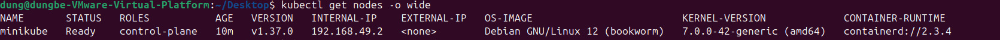

tên phần mềm để triển khai minikube đã được ready sẵn sàng được tạo 10p trước và phiên bản v1.37.0, control-plane là cụm điều khiển trung tâm quản lí bộ thành phần cụm k8s

Câu lệnh lkubectl get nodes dùng để liệt kê các worker node trong cụm cluster với định dạng hiển thị chi tiết

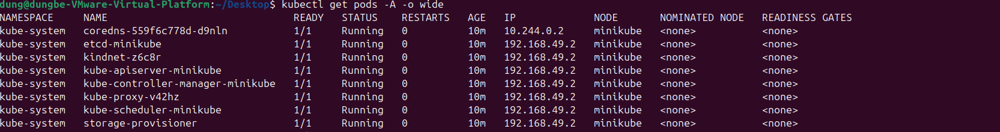

lệnh thực thi kubectl get pods -A -o wide dùng để liệt kê các pod trong tất cả các namespaces với định dạng cụ thể

- coredns-...: Cung cấp dịch vụ phân giải tên miền nội bộ (DNS) trong cụm.
- etcd-minikube: Cơ sở dữ liệu phân tán lưu trữ toàn bộ trạng thái và cấu hình của cụm Kubernetes.
- kindnet-...: Plugin mạng (CNI) giúp các pod có thể giao tiếp với nhau.
- kube-apiserver-minikube: Cổng giao tiếp chính (API Server) nhận các lệnh từ kubectl.
- kube-controller-manager-minikube: Trình quản lý các vòng lặp điều khiển (controller loops) của cụm.
- kube-proxy-v42hz: Xử lý định tuyến mạng và quy tắc load balancing cho các service.
- kube-scheduler-minikube: Quyết định chọn node nào để đặt các pod mới được tạo.
- storage-provisioner: Cung cấp ổ đĩa lưu trữ động cho các yêu cầu cấp phát ổ đĩa (PVC) trong Minikube.

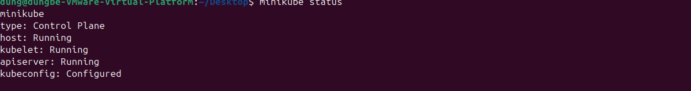

Lệnh thực thi (minikube status): Lệnh này dùng để kiểm tra nhanh trạng thái hoạt động hiện tại của cụm Minikube và các thành phần cốt lõi bên trong nó.

Chi tiết các thông số trạng thái:

- minikube: Tên cụm hoặc cấu hình hiện tại đang được kiểm tra.
- type: Control Plane: Cho biết node này đóng vai trò là cụm điều khiển trung tâm (Control Plane), quản lý toàn bộ hệ thống Kubernetes.
- host: Running: Máy ảo (VM) hoặc môi trường chứa Minikube đang chạy bình thường.
- kubelet: Running: Tiến trình kubelet (agent chính chạy trên node để quản lý các pod và container) đang hoạt động ổn định.
- apiserver: Running: Cổng giao tiếp chính kube-apiserver đang chạy và sẵn sàng nhận các yêu cầu từ câu lệnh kubectl.
- kubeconfig: Configured: Tệp cấu hình kết nối (kubeconfig) đã được thiết lập chính xác, giúp công cụ kubectl có thể giao tiếp mượt mà với cụm Minikube.

---

## LAB2

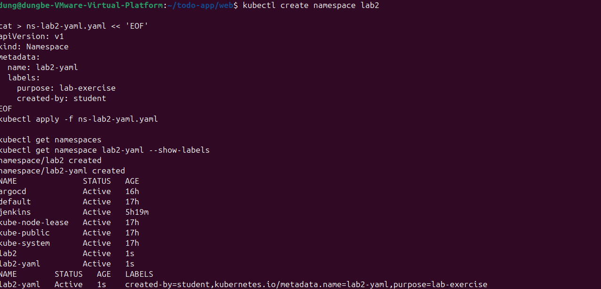

Tạo được namespace cho k8s

- kubectl create namespace lab2 tạo namespace lab2 bằng lệnh trực tiếp.
- File ns-lab2-yaml.yaml tạo namespace lab2-yaml kèm hai label purpose: lab-exercise và created-by: student, rồi được apply bằng kubectl apply.
- kubectl get namespaces cho thấy cả hai đều Active. Dòng cuối hiện đúng label.

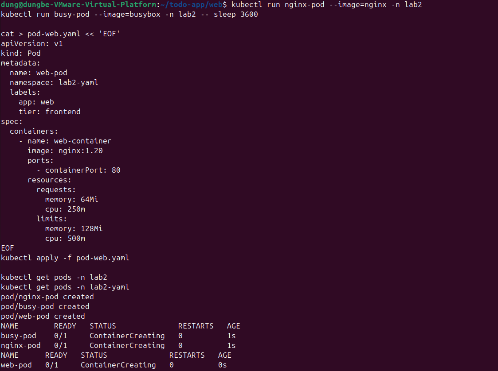

Taọ pod cho k8s

- nginx-pod và busy-pod được tạo trong lab2 bằng kubectl run. busy-pod chạy sleep 3600.
- web-pod được tạo trong lab2-yaml bằng YAML, với image nginx:1.20, label app: web và tier: frontend, cùng request và limit tài nguyên như đề.
- Lúc đầu cả ba đều ContainerCreating vì đang tải image, sau đó chuyển sang Running.

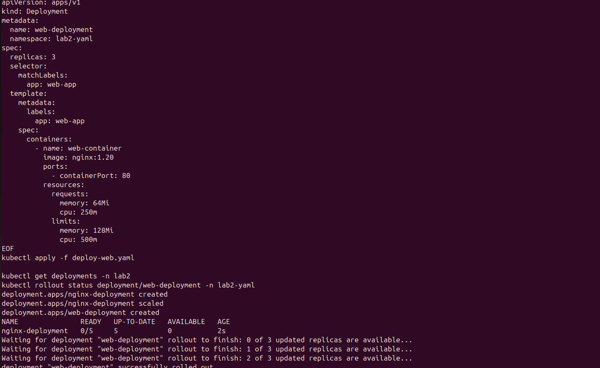

Tạo deployment cho k8s

- nginx-deployment được tạo trong lab2 với 3 replica, rồi scale lên 5 (dòng scaled).
- web-deployment được tạo từ deploy-web.yaml trong lab2-yaml, với 3 replica, label app: web-app và resource đúng như đề. Rollout báo successfully rolled out.

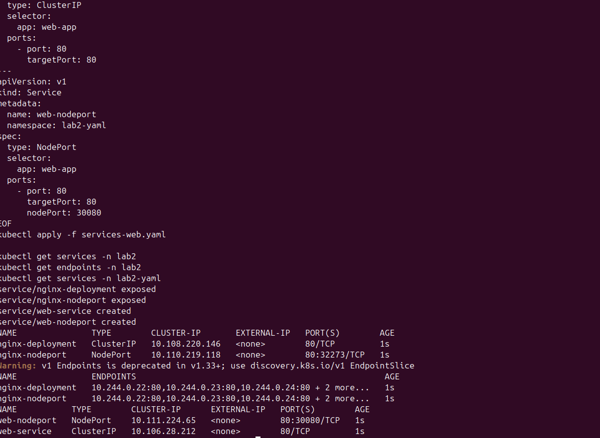

Tạo service cho k8s

- kubectl expose tạo nginx-deployment (ClusterIP, port 80) và nginx-nodeport (NodePort, port 80 map sang 32273).
- File services-web.yaml tạo web-service (ClusterIP) và web-nodeport (NodePort 30080) trong lab2-yaml, đúng như đề yêu cầu.
- Cảnh báo Endpoints is deprecated không ảnh hưởng gì, chỉ là thông báo của Kubernetes.

TIẾP THEO STACK CHO K8S

viết file yaml tách theo từng loại object

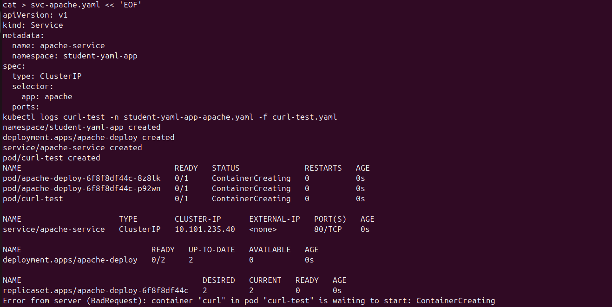

- Pod busybox tạm thời gọi http://nginx-deployment và nhận trang HTML Welcome to nginx!. Điều này chứng minh service hoạt động.
- Pod tự xóa sau khi chạy xong nhờ tham số --rm.

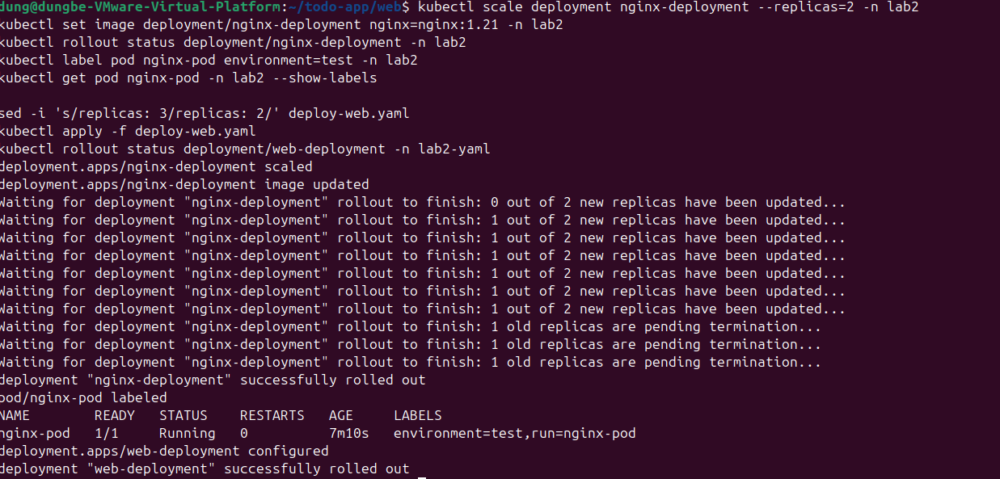

Sưa lại object cho k8s

- Namespace student-yaml-app, deployment apache-deploy (2 replica, httpd:2.4), service apache-service (ClusterIP) và pod curl-test được tạo.
- Lệnh kubectl logs lúc đó báo lỗi ContainerCreating vì pod chưa chạy xong, nên chưa có kết quả.
- Có một dòng kubectl logs curl-test -n student-yaml-app-apache.yaml -f curl-test.yaml lọt vào phần heredoc. Có thể nó đã được ghi vào svc-apache.yaml, nên cần kiểm tra lại file này.

Tiếp tục là quan hệ và tài nguyên

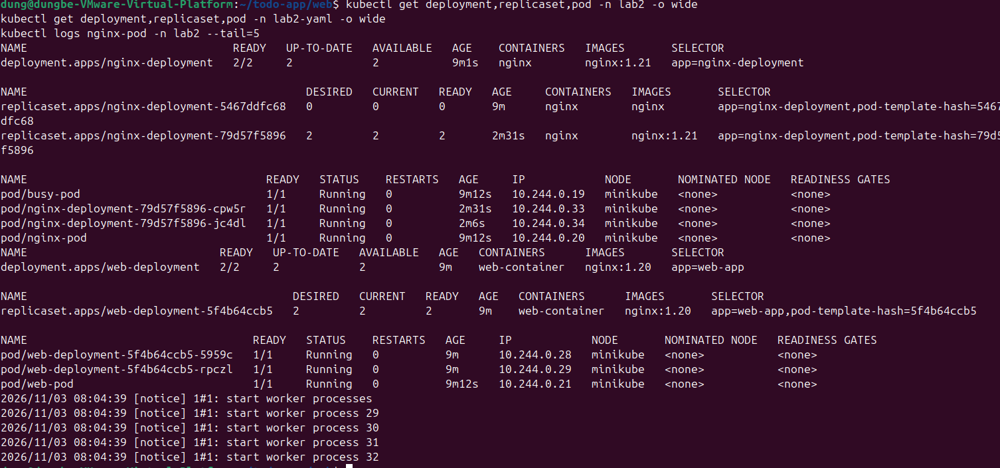

- Deployment nginx-deployment (lab2, nginx:1.21) quản lý 2 ReplicaSet. ReplicaSet cũ 5467ddfc68 có 0 pod sau khi đổi image, ReplicaSet mới 79d57f5896 có 2 pod đang chạy. Đây là kết quả của rolling update ở phần 7.
- ReplicaSet giữ đúng số lượng pod mong muốn (DESIRED = CURRENT = READY).
- Pod có tên được ghép từ tên ReplicaSet và mã ngẫu nhiên, ví dụ nginx-deployment-79d57f5896-cpw5r.
- Deployment web-deployment (lab2-yaml) đã có 2 pod sau khi sửa từ 3 xuống 2, và pod được gắn selector app=web-app.
- Log của nginx-pod cho thấy nginx đã khởi động worker processes, nên pod hoạt động bình thường.

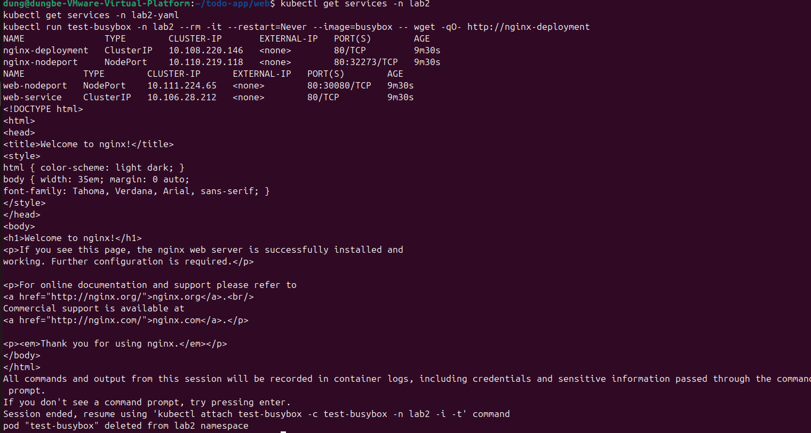

- lab2: nginx-deployment là ClusterIP port 80, nginx-nodeport là NodePort 32273.
- lab2-yaml: web-service là ClusterIP port 80, web-nodeport là NodePort 30080 đúng như đề.
- Kiểm tra kết nối: pod busybox gọi http://nginx-deployment và nhận trang Welcome to nginx!, nên service hoạt động.

---

## LAB3

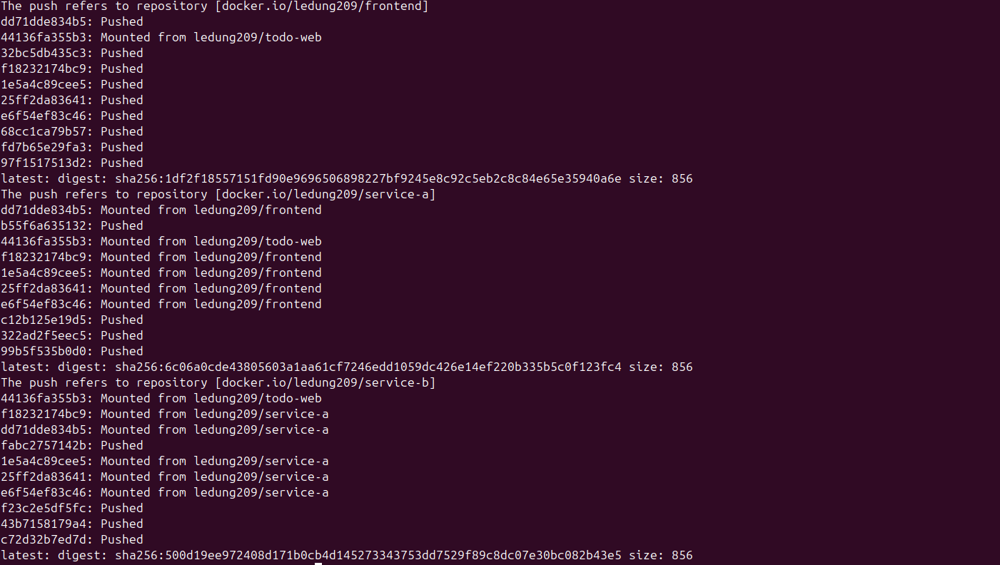

Build và push image

Ba image ledung209/frontend, ledung209/service-a và ledung209/service-b được đẩy lên Docker Hub với tag latest. Mỗi repo kết thúc bằng dòng latest: digest: sha256:..., xác nhận image đã có trên registry. Các layer được hiển thị Mounted from ... là các lớp dùng chung giữa các image, nên không cần đẩy lại.

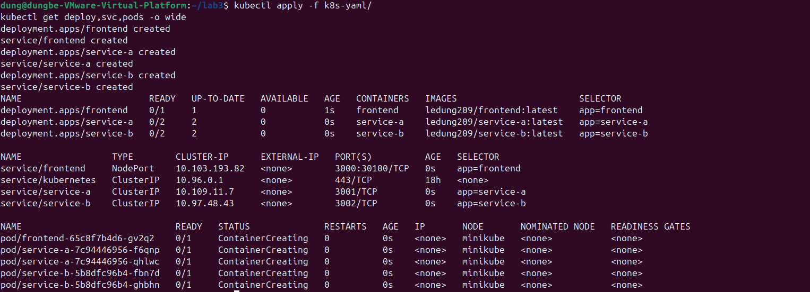

apply

Lệnh kubectl apply -f k8s-yaml/ tạo ba Deployment (frontend, service-a, service-b) và bốn Service. Service frontend là NodePort với cổng 3000:30100, nghĩa là truy cập từ bên ngoài qua cổng 30100. Hai Service service-a và service-b là ClusterIP, chỉ truy cập được trong cluster. Lúc này các pod còn ở trạng thái ContainerCreating vì đang tải image về.

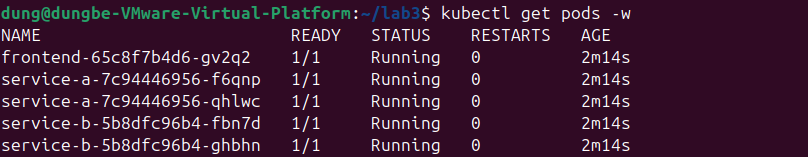

Kiểm tra trạng thái của 5 pod

Sau khoảng 2 phút, cả 5 pod đều 1/1 Running với RESTARTS là 0: 1 pod frontend, 2 pod service-a và 2 pod service-b. Điều này cho thấy image đã được kéo về và container khởi động thành công.

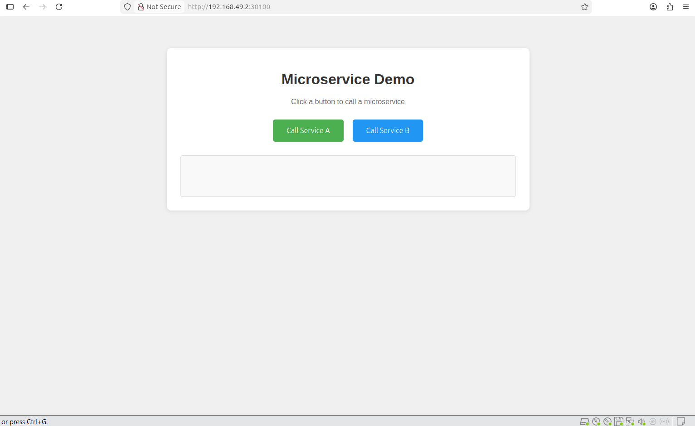

Trang frontend đã được mở qua nodeporrt 30100

Trình duyệt truy cập http://192.168.49.2:30100, là địa chỉ IP của minikube kết hợp với cổng NodePort của Service frontend. Trang hiển thị hai nút Call Service A và Call Service B, chứng minh frontend đã chạy và có thể truy cập từ bên ngoài cluster

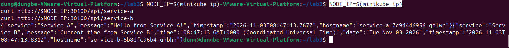

Hình 5. Kiểm tra API bằng curl

Hai lệnh curl gọi tới /api/service-a và /api/service-b qua cổng 30100. Frontend chuyển tiếp các request này tới Service service-a:3001 và service-b:3002 bên trong cluster. Kết quả trả về JSON của cả hai service, trong đó trường hostname là tên pod đang xử lý request (service-a-7c94446956-qhlwc và service-b-5b8dfc96b4-ghbhn). Tên hostname khớp với danh sách pod ở Hình 3, chứng minh request đã đi qua Service đến đúng pod.

Lab 3 được thực hiện bằng cách sửa các file YAML còn thiếu và sai (replicas, selector, containerPort, targetPort, apiVersion), thay thế placeholder ledung209 bằng tài khoản Docker Hub, đẩy image lên registry, sau đó apply và kiểm tra. Toàn bộ luồng Internet → NodePort → Frontend → Service → Pod hoạt động đúng.

---

## LAB4

Dữ liệu gồm 4 bảng: customers, orders, order_items, products. Quan hệ: một khách có nhiều đơn, một đơn có nhiều dòng order_items, mỗi dòng trỏ tới một sản phẩm.

Tạo PVC deployment và service cho postgreSGL

Hình 1 và 2. PVC và pod ở trạng thái Pending ban đầu

Ngay sau khi apply, postgres-pvc ở trạng thái Pending và pod postgres cũng Pending. Trong danh sách PV xuất hiện pvc-ef0d8e77... được cấp phát tự động cho default/postgres-pvc với StorageClass standard. Service postgres-nodeport đã được tạo, cổng 5432:30432. Trạng thái Pending là bước chờ cấp phát ổ đĩa, sau đó chuyển sang Bound khi pod khởi động.

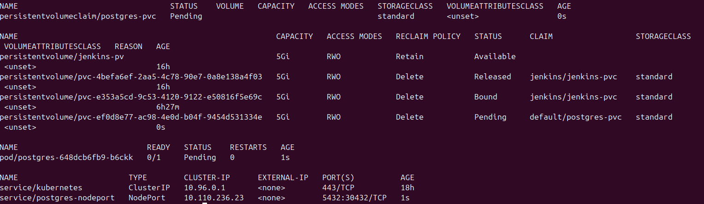

Biến PGDATA trỏ vào thư mục con để tránh lỗi lost+found khi PVC được tạo sẵn thư mục.

Chờ đến khi postgres-pvc ở trạng thái Bound và pod postgres-... là 1/1 Running.

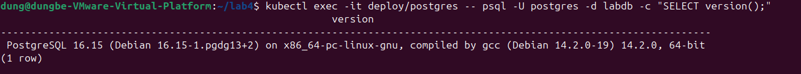

posgresql đã sẵn sàng

Lệnh SELECT version(); chạy trong pod cho kết quả PostgreSQL 16.15, xác nhận database đã chạy và có thể kết nối từ bên ngoài pod.

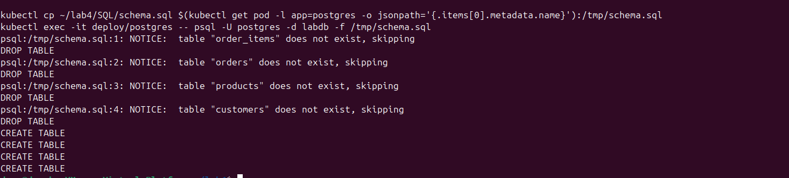

tạo schema postgreSQL

File schema.sql được copy vào pod và chạy bằng psql -f. Các thông báo DROP TABLE kèm does not exist, skipping là bình thường vì đây là lần chạy đầu tiên. Bốn lệnh CREATE TABLE cho customers, products, orders và order_items cho thấy schema đã được tạo đúng.

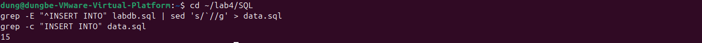

chuyển dữ liệu mysal sang postgresql

In ra 15 đúng với số lệnh insert gốc

Lệnh grep lọc các dòng INSERT INTO từ labdb.sql, sed bỏ dấu backtick để tương thích với PostgreSQL, và kết quả được ghi vào data.sql. Lệnh grep -c cho ra 15, nghĩa là có 15 lệnh INSERT.

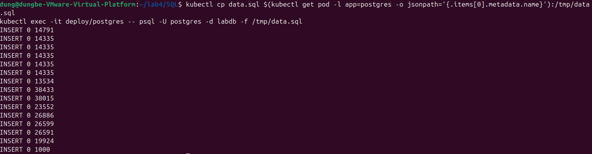

nập dữ liệu vào database

File data.sql được copy vào pod và chạy. Mỗi dòng INSERT 0 n là một lệnh đã thành công, với n là số dòng được thêm. Tổng số dòng nạp vào khớp với dữ liệu trong dump.

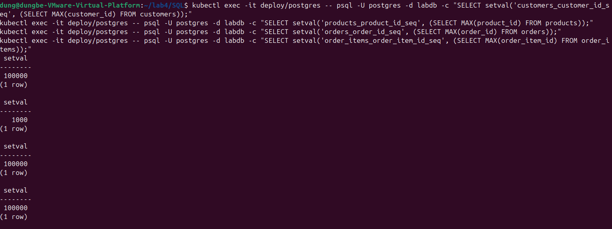

cập nhật lại bộ đêm serial để lần inset tiêp hông bị trùng iD

Bốn lệnh setval cập nhật bộ đếm tự tăng về giá trị lớn nhất hiện có của mỗi bảng: customers 100000, products 1000, orders 100000, order_items 100000. Bước này cần làm vì dữ liệu được nạp với ID cố định, nếu không thì lần INSERT sau sẽ bị trùng khóa.

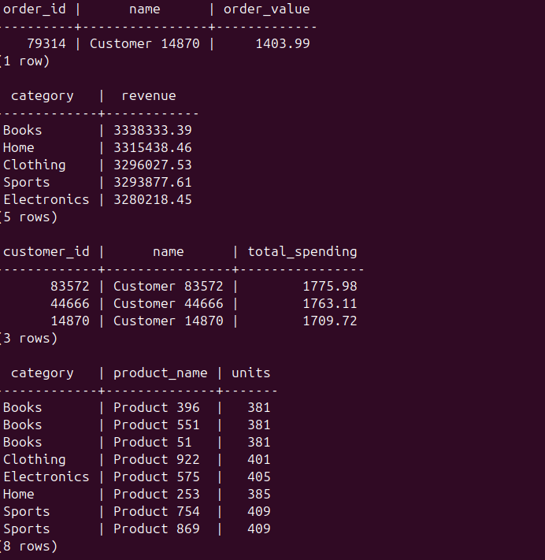

một mẫu query được in ra trên một bảng

Kết quả liệt kê tổng chi tiêu của các khách hàng theo thứ tự giảm dần. Khách hàng có chi tiêu cao nhất là Customer 83572 với 1775.98. Ảnh chỉ hiện phần đầu của bảng vì truy vấn không giới hạn số dòng.

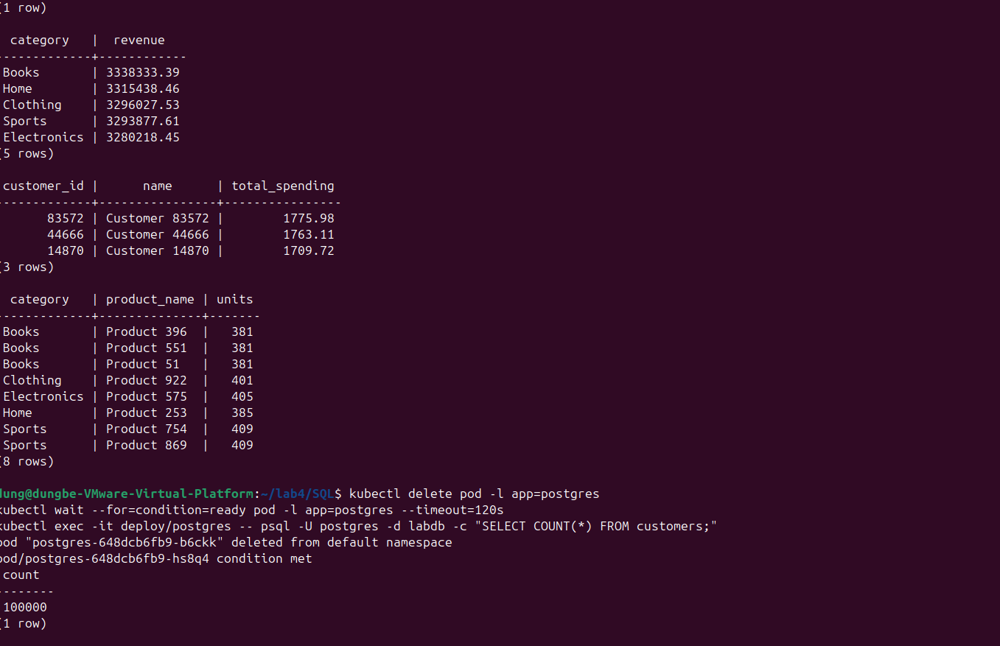

- Dữ liệu được nạp đầy đủ: bảng customers có 100000 dòng sau khi pod được tạo lại.
- Dữ liệu được giữ lại qua restart: bạn xóa pod postgres-648dcb6fb9-b6ckk, Kubernetes tạo pod mới hs8q4, và COUNT(*) vẫn là 100000. Đây là bằng chứng PVC hoạt động đúng.
- Truy vấn 3.3 (doanh thu theo danh mục): 5 danh mục, từ Books khoảng 3,34 triệu đến Electronics khoảng 3,28 triệu.
- Truy vấn 3.4 (top 3 khách): Customer 83572 (1775.98), Customer 44666 (1763.11), Customer 14870 (1709.72).
- Truy vấn 3.5 (bán chạy nhất mỗi danh mục): trả về 8 dòng thay vì 5 vì có hòa điểm. Ví dụ Books có ba sản phẩm cùng 381 đơn vị, nên RANK() giữ cả ba. Đây là kết quả đúng với cách tính đó. Nếu đề yêu cầu đúng một sản phẩm mỗi danh mục, đổi RANK() thành ROW_NUMBER() trong file queries.sql. Bạn ghi chú điều này trong báo cáo.

---

## LAB5

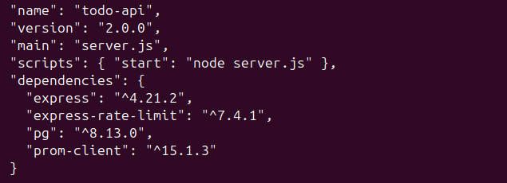

File package.json của todo-api phiên bản 2.0.0, thêm thư viện pg để kết nối PostgreSQL, bên cạnh Express, express-rate-limit và prom-client.

sửa backend để dùng postgreSQGL

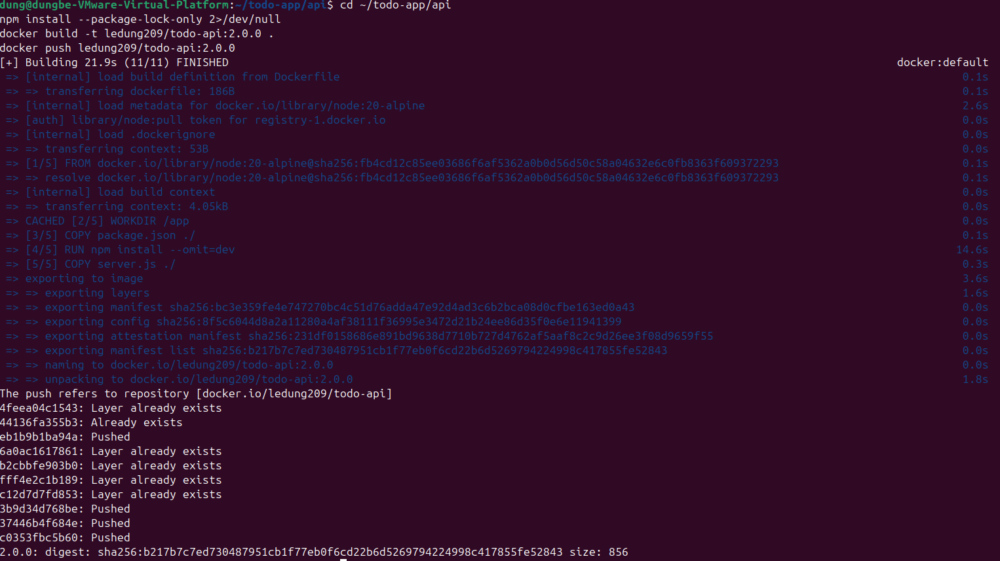

Image ledung209/todo-api:2.0.0 được build từ Dockerfile và đẩy lên Docker Hub, với digest sha256:b217b7c7.... Các layer ghi Already exists là lớp dùng chung với các image trước, không cần đẩy lại. Tag 2.0.0 được dùng thay vì ghi đè 1.0.0.

build và push backend tag mới 2.0

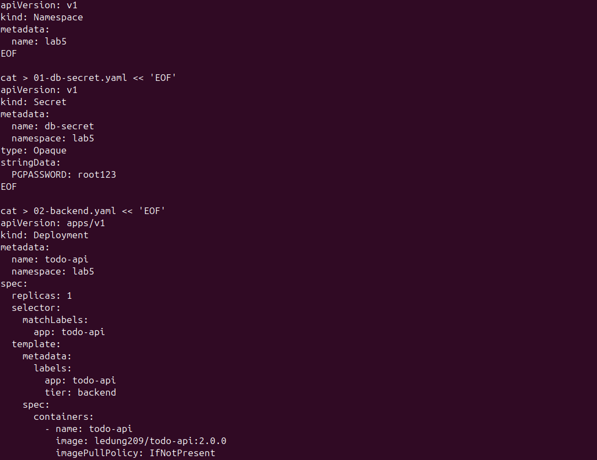

tạo thư mục yaml và namespace cho lab5

Frontend gọi backend qua tên Service todo-api trong cùng namespace. Backend gọi database qua tên đầy đủ postgres-nodeport.default.svc.cluster.local, vì database nằm ở namespace default.

Bốn file được tạo trong thư mục ~/lab5/k8s: 00-namespace.yaml tạo namespace lab5, 01-db-secret.yaml lưu mật khẩu database dạng Secret, 02-backend.yaml gồm Deployment và Service cho backend, 03-frontend.yaml gồm Deployment và Service cho frontend. Mật khẩu được tách khỏi Deployment, nên không nằm trực tiếp trong cấu hình chạy.

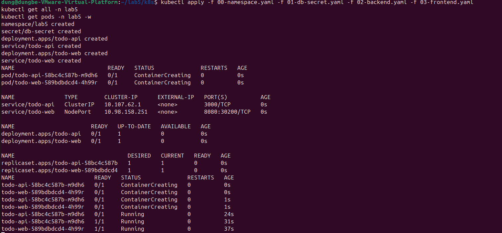

apply

Lệnh kubectl apply tạo đầy đủ namespace, secret, hai Deployment và hai Service trong lab5. Lúc đầu các pod ở trạng thái ContainerCreating, sau đó chuyển sang Running với READY 1/1: todo-api mất khoảng 31 giây, todo-web khoảng 37 giây. Service todo-web là NodePort, cổng 30200, còn todo-api là ClusterIP, chỉ truy cập được trong cluster.

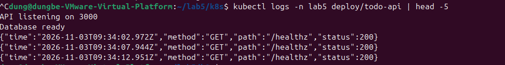

kiểm tra database kết nối backend

Lệnh kubectl apply tạo đầy đủ namespace, secret, hai Deployment và hai Service trong lab5. Lúc đầu các pod ở trạng thái ContainerCreating, sau đó chuyển sang Running với READY 1/1: todo-api mất khoảng 31 giây, todo-web khoảng 37 giây. Service todo-web là NodePort, cổng 30200, còn todo-api là ClusterIP, chỉ truy cập được trong cluster.

Giao diện Todo App được mở qua NodePort 30200. Người dùng đăng nhập bằng admin, bấm Tải danh sách và thấy hai việc: untitled và lamk8slab. Điều này chứng minh frontend gọi được backend, và backend lấy được dữ liệu từ database

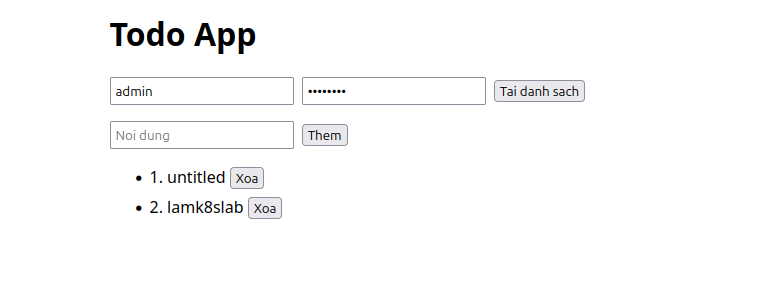

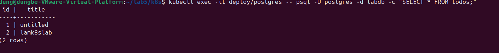

sau khi xử lí trên web thêm 2 việc thì trong database cũng đã được lưu lại

Ứng dụng Todo gồm ba thành phần được triển khai trong namespace lab5: frontend (todo-web), backend (todo-api) và database PostgreSQL (dùng lại từ lab 4). Frontend gọi backend qua Service todo-api (ClusterIP), backend gọi database qua Service postgres-nodeport. Các kết nối được xác nhận qua log khởi động (Hình 6), giao diện người dùng (Hình 7) và dữ liệu trong database (Hình 8).

Giao diện Todo App được mở qua NodePort 30200. Người dùng đăng nhập bằng admin, bấm Tải danh sách và thấy hai việc: untitled và lamk8slab. Điều này chứng minh frontend gọi được backend, và backend lấy được dữ liệu từ database.

Ứng dụng Todo gồm ba thành phần được triển khai trong namespace lab5: frontend (todo-web), backend (todo-api) và database PostgreSQL (dùng lại từ lab 4). Frontend gọi backend qua Service todo-api (ClusterIP), backend gọi database qua Service postgres-nodeport. Các kết nối được xác nhận qua log khởi động (Hình 6), giao diện người dùng (Hình 7) và dữ liệu trong database (Hình 8).

---

## LAB 6

BƯỚC KẾ TIẾP LÀ CÀI ARGOCD VÀ JENKINS

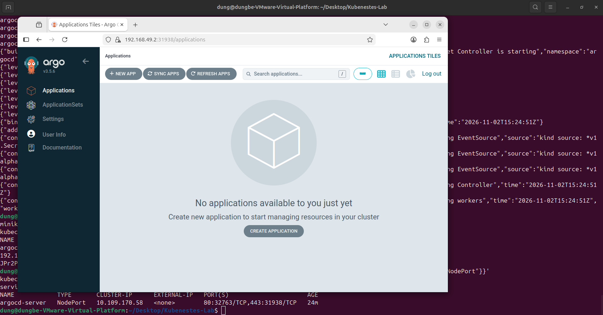

Truy cập argocd trên vmware ubuntu

bước đầu phải tạo thư mục dữ liệu trên node minikube

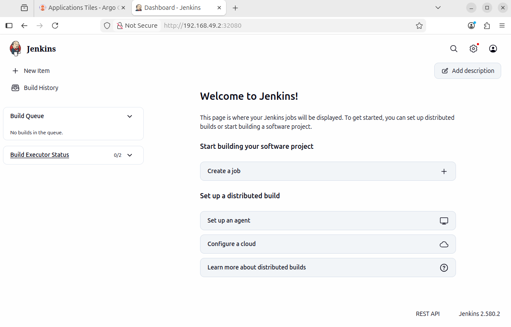

Đã vô được giao diện của jenkins trên máy ảo ubuntu

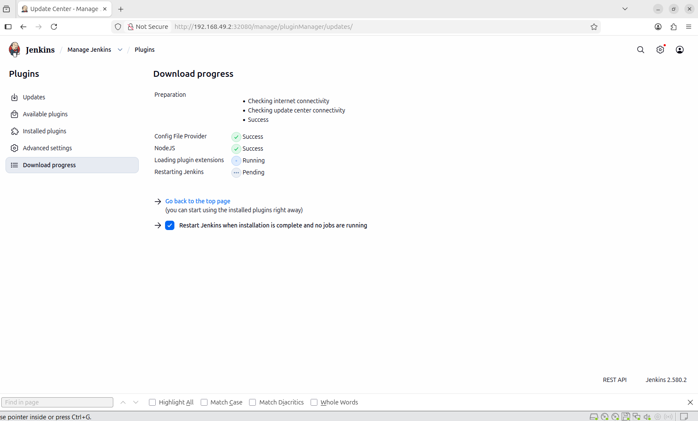

Cài nodejs trên jenkins trong máy ảo vmware

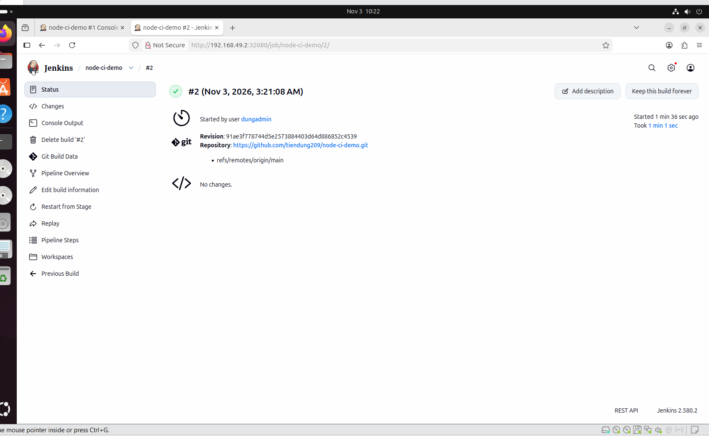

Build #2 đã thành công (dấu tích xanh). Jenkins đã clone repo, đọc được jenkinsfile và chạy xong các stage.

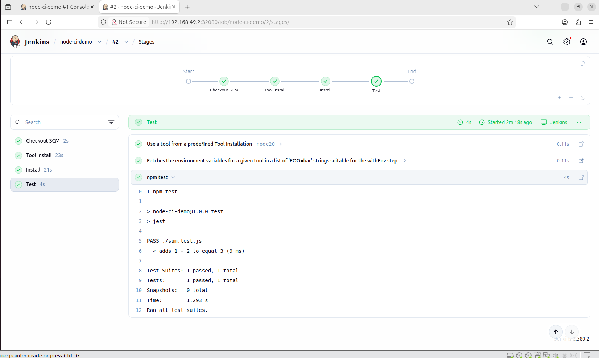

Trang Stages cho thấy pipeline chạy đủ: Checkout SCM, Tool Install (node20), Install và Test đều xanh. Log npm test có Tests: 1 passed, 1 total

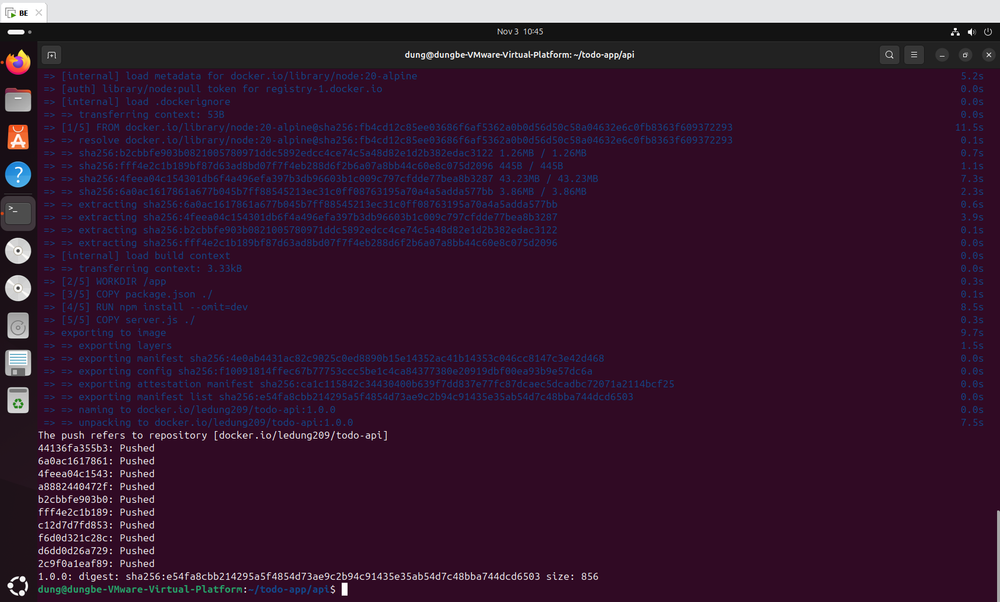

Image api đã push thành công

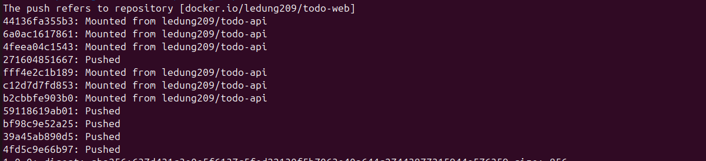

Image web đã push thành công

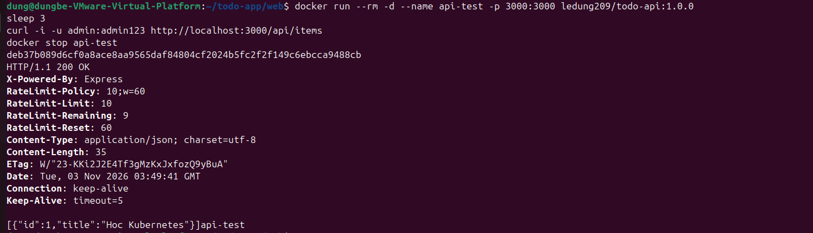

1793677808008_image.png

Container chạy từ image ledung209/todo-api:1.0.0 trên Docker Hub trả về HTTP/1.1 200 OK, và danh sách có một việc Hoc Kubernetes. Đây là chứng cứ đầy đủ rằng image hoạt động đúng. Dòng RateLimit-Remaining: 9 và kết quả khác với lần trước (chỉ còn id: 1, vì id: 3 đã bị xóa trong lúc kiểm tra) cũng xác nhận đây là container mới.

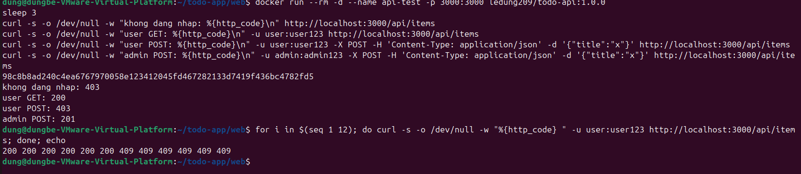

Kết quả đều đúng như mong đợi:

- Không đăng nhập: 403
- User GET: 200
- User POST: 403
- Admin POST: 201

Dãy rate limit 200 200 200 200 200 200 409 409 409 409 409 409 cũng đúng. Lý do có 6 request 200 thay vì 10 là vì 4 request trước đó (không đăng nhập, user GET, user POST, admin POST) đã được tính vào cùng cửa sổ 1 phút. Rate limit đếm mọi request tới /api/items, kể cả request bị 403, nên tổng vẫn là 10 request thành công trong một phút. Phần API đã đạt yêu cầu.

Monitoring	Metrics, Prometheus qua Ansible

---

## LAB7

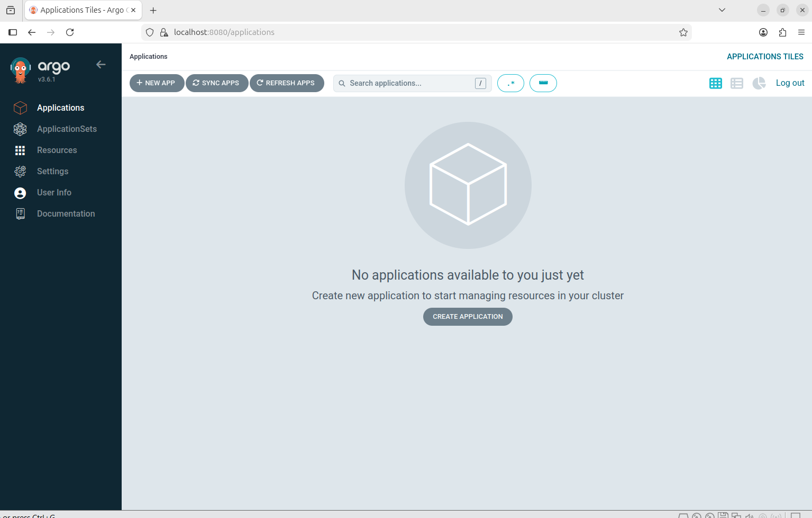

Giao diện ArgoCD v3.6.1 tại localhost:8080, chưa có ứng dụng nàO,

Đăng nhập thành công vào ArgoCD, chưa có ứng dụnG

- Địa chỉ: localhost:8080/applications, giao diện ArgoCD phiên bản v3.6.1.
- Nội dung: dòng chữ “No applications available to you just yet”, tức là chưa có ứng dụng nào.
- Ý nghĩa: ArgoCD đã được cài trên cluster, cổng 8080 đã được chuyển tiếp thành công và bạn đăng nhập được với tài khoản admin. Ảnh này chứng minh bước cài đặt và truy cập đã hoàn thành, chưa có gì được triển khai.

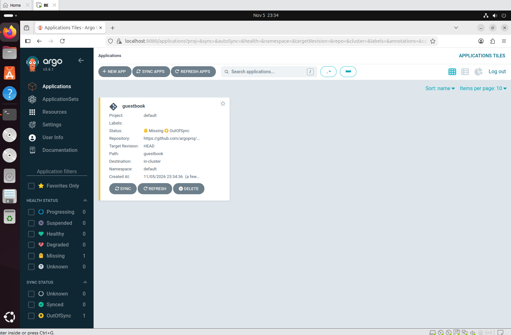

Trạng thái:

- OutOfSync: cấu hình trong Git và trên cluster chưa khớp nhau.
- Missing: tài nguyên được khai báo trong Git nhưng chưa tồn tại trên cluster.
- Ý nghĩa: ArgoCD đã đọc được file cấu hình từ GitHub, nhưng bạn chưa bấm Sync nên chưa có gì được tạo.

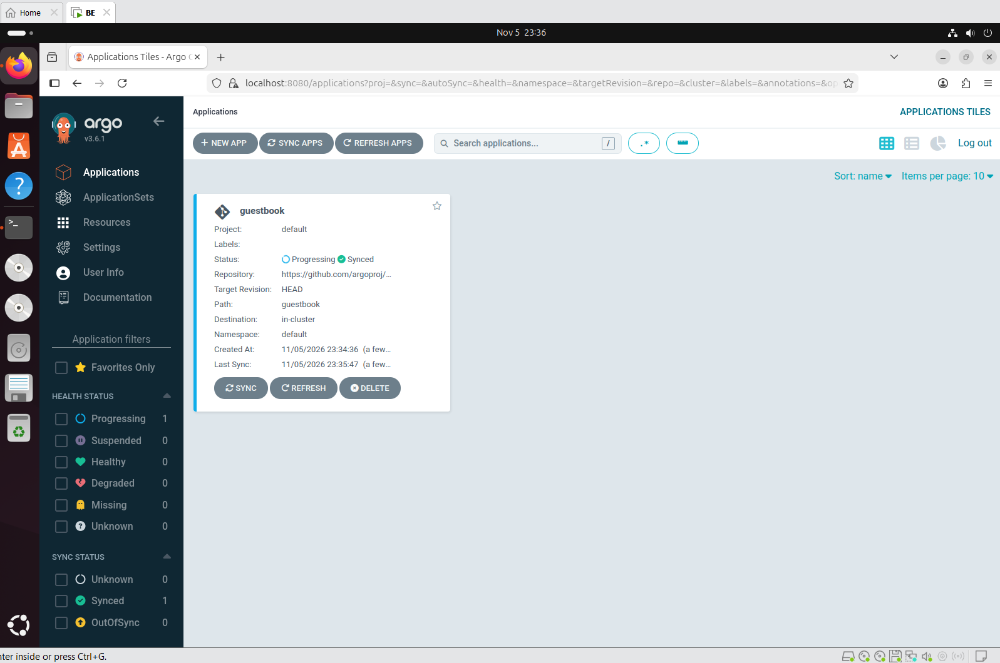

Trạng thái:

- Synced: cluster đã khớp với Git. ArgoCD đã áp dụng manifest.
- Progressing: các pod vẫn đang khởi động, chưa đạt trạng thái Healthy.
- Ý nghĩa: bước đồng bộ đã thành công. Trạng thái Progressing là bình thường ngay sau khi sync, vì pod cần thời gian tải image và chạy. Ảnh này không chứng minh ứng dụng đã sẵn sàng, phần đó nằm ở ảnh 4.

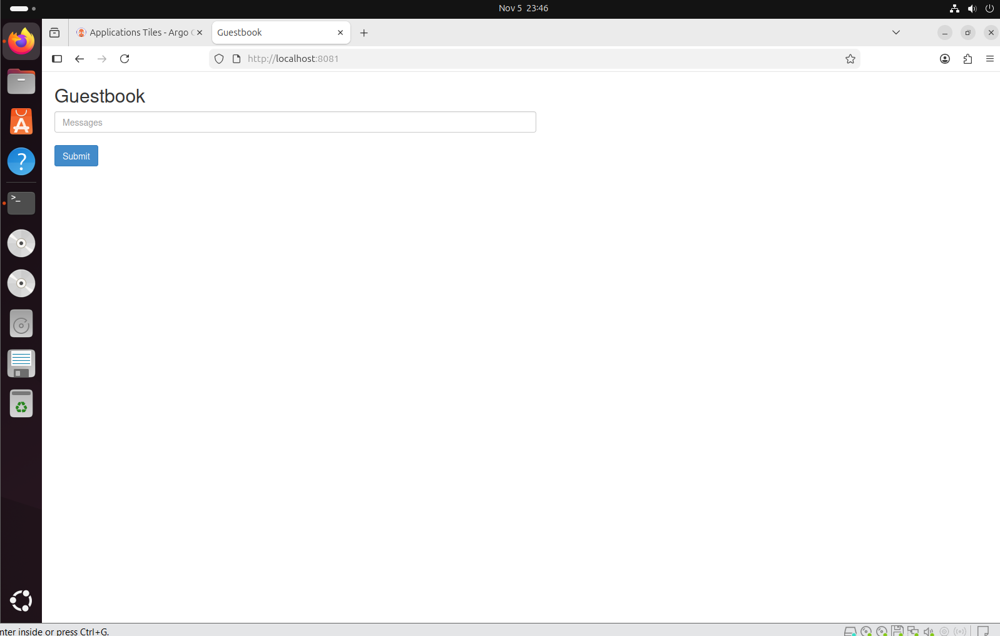

- Địa chỉ: http://localhost:8081, tab có tiêu đề “Guestbook”.
- Nội dung: trang có tiêu đề “Guestbook”, một ô nhập “Messages” và nút “Submit”.
- Ý nghĩa: ứng dụng đã chạy thật sự trên cluster và trả về giao diện web. Cổng 8081 được chuyển tiếp từ service guestbook-ui trong namespace default, nên ảnh chứng minh chuỗi Git → ArgoCD → Kubernetes → trình duyệt đã hoạt động.

---

## LAB8

**Nhóm 1: Chuẩn bị môi trường cài Elasticsearch.**

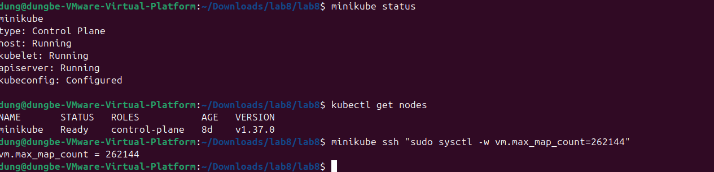

- minikube status: cho thấy Minikube đang chạy (host, kubelet, apiserver đều Running).
- kubectl get nodes: node minikube ở trạng thái Ready, phiên bản Kubernetes v1.37.0.
- minikube ssh "sudo sysctl -w vm.max_map_count=262144": tăng giới hạn số vùng bộ nhớ ảo cho máy ảo Minikube. Elasticsearch yêu cầu giá trị này tối thiểu 262144 để khởi động, nếu không pod sẽ lỗi.

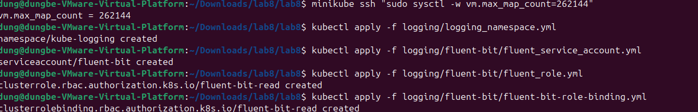

Tạo namespace và phân quyền Fluent Bit

- kubectl apply -f logging/logging_namespace.yml: tạo namespace kube-logging, nơi chứa toàn bộ thành phần logging.
- fluent_service_account.yml: tạo ServiceAccount fluent-bit, là “danh tính” để pod Fluent Bit gọi Kubernetes API.
- fluent_role.yml: tạo ClusterRole fluent-bit-read, cấp quyền đọc pod và namespace.
- fluent-bit-role-binding.yml: gắn quyền đó cho ServiceAccount.

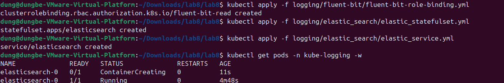

- elastic_statefulset.yml: tạo StatefulSet elasticsearch. StatefulSet phù hợp với cơ sở dữ liệu vì mỗi pod có tên cố định (elasticsearch-0) và gắn với một ổ đĩa riêng.
- elastic_service.yml: tạo Service elasticsearch để các thành phần khác gọi đến.
- kubectl get pods -n kube-logging -w: theo dõi realtime. Ban đầu elasticsearch-0 là 0/1 ContainerCreating, sau khoảng 4 phút 48 giây thì chuyển sang 1/1 Running. Đây là trạng thái bình thường, vì Elasticsearch khởi động khá chậm.

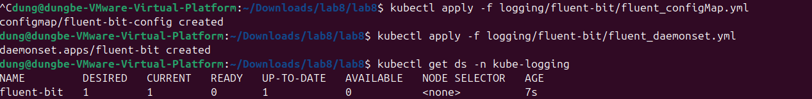

- fluent_configMap.yml: tạo ConfigMap fluent-bit-config, chứa cấu hình: đọc file log nào, parse như thế nào, gửi đến địa chỉ Elasticsearch nào.
- fluent_daemonset.yml: tạo DaemonSet fluent-bit. DaemonSet đảm bảo mỗi node có đúng một pod Fluent Bit.
- kubectl get ds -n kube-logging: cột DESIRED 1, CURRENT 1. Lúc này READY còn là 0 vì pod đang khởi động.

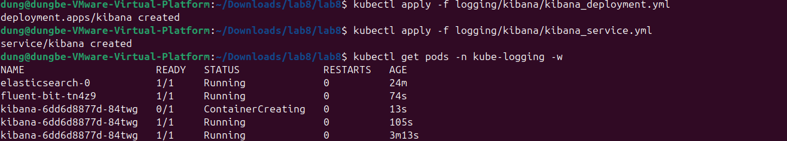

- kibana_deployment.yml: tạo Deployment kibana, pod Kibana kết nối đến Elasticsearch.
- kibana_service.yml: tạo Service kibana, kiểu NodePort để truy cập từ bên ngoài.
- Lệnh get pods -w cho thấy pod Kibana đi từ ContainerCreating sang 1/1 Running sau khoảng 105 giây.

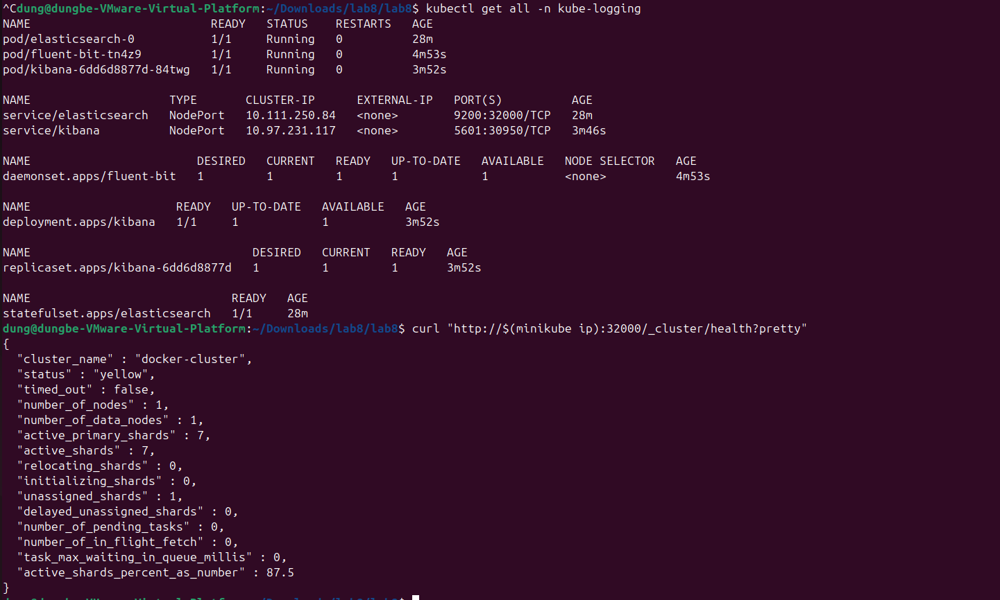

Kiểm tra tổng thể và sức khỏe Elasticsearch

Phần 1: kubectl get all -n kube-logging

Lệnh liệt kê tất cả tài nguyên trong namespace:

- Pod: elasticsearch-0, fluent-bit-tn4z9, kibana-... đều 1/1 Running, RESTARTS 0.
- Service: elasticsearch (NodePort 9200:32000) và kibana (NodePort 5601:30950).
- DaemonSet fluent-bit: DESIRED 1, READY 1.
- Deployment kibana: READY 1/1.
- StatefulSet elasticsearch: READY 1/1.

Ảnh này chứng minh toàn bộ hệ thống đã chạy.

Phần 2: curl đến cổng 32000 để kiểm tra sức khỏe cluster Elasticsearch

Kết quả có "status" : "yellow". Trạng thái này không phải lỗi nghiêm trọng. Giải thích:

- Elasticsearch có một cơ chế gọi là replica shard (bản sao dữ liệu) để dự phòng.
- Cluster chỉ có một node, mà bản sao phải nằm trên node khác với bản chính. Vì vậy có 1 shard không được gán (unassigned_shards: 1).
- active_primary_shards: 7 và active_shards_percent_as_number: 87.5 cho thấy dữ liệu chính đã sẵn sàng, dữ liệu vẫn truy vấn được.

- Thanh địa chỉ: http://192.168.49.2:30950. Đây là IP của Minikube và cổng NodePort của Kibana.
- Trang Home của Elastic hiện ra, chứng minh Kibana đã kết nối được với Elasticsearch.
- Thông báo “Your data is not secure” xuất hiện vì lab này tắt bảo mật (không có TLS, không có đăng nhập). Đây là cấu hình có chủ đích cho môi trường học tập, không phải lỗi.

Trong Kibana, vào Stack Management → Index patterns, tạo pattern fluent-bit-*:

- Pattern fluent-bit-* khớp với mọi index bắt đầu bằng fluent-bit-, tức là các index do Fluent Bit tạo ra.
- Time field là @timestamp, giúp Kibana lọc theo thời gian.
- Trang hiển thị 8 field, trong đó log là nội dung dòng log và log.keyword là bản để lọc chính xác.

Trang Discover hiển thị 1.613 hits trong khoảng thời gian đã chọn. Mỗi dòng là một log do container ghi ra. Ví dụ:

- Log của chính Kibana khi bạn truy cập giao diện ("method":"get", "url":"/api/saved_objects/_bulk_get").
- Biểu đồ phía trên thể hiện số lượng log theo từng 30 giây.

Ảnh này chứng minh Fluent Bit đã thu thập và gửi log thành công.

- Tạo file log-generator.yml định nghĩa một Pod tên log-generator, dùng image busybox.
- Container chạy vòng lặp while true; do echo "hello-from-log-generator $(date)"; sleep 5; done, cứ 5 giây in một dòng log.
- kubectl apply -f log-generator.yml tạo pod thành công.
- kubectl logs log-generator lấy log ra terminal.

Mục đích là tạo một nguồn log có nội dung nhận biết được, để kiểm tra việc tìm kiếm trong Kibana.

Trong Discover, nhập truy vấn KQL:

log : "hello-from-log-generator"

Kết quả: 14 hits, mỗi dòng đều chứa chuỗi hello-from-log-generator, và các từ được tô vàng. Các dòng có timestamp cách nhau khoảng 5 giây, khớp với sleep 5 trong script

tạo visualization

- Vào Visualize Library → Create, chọn kiểu Date Histogram với field @timestamp.
- Biểu đồ cột thể hiện số lượng log theo từng phút trong 1 giờ gần nhất.
- Bấm Save để lưu vào thư viện.

- Trong Dashboard, chọn kiểu Bar vertical stacked và đặt trục dọc là Count of records (đếm số bản ghi).
- Trục ngang là @timestamp per minute.
- Chỉ số 5.299 ở phần gợi ý là tổng số log trong khoảng thời gian đã chọn.
- Ô tìm kiếm có chữ len ở dưới cùng là thanh Ctrl+F của trình duyệt, không liên quan đến Kibana

triển khai chart bằng Helm

- kubectl create ns lab9 || true: tạo namespace lab9. Dấu || true nghĩa là nếu namespace đã tồn tại thì không báo lỗi.
- helm install lab-web ./myweb -n lab9: cài chart myweb từ thư mục cục bộ với tên release lab-web.
- Helm báo STATUS: deployed và REVISION: 1, nghĩa là lần cài đầu tiên thành công.
- Helm tạo một Service lab-web-myweb (ClusterIP, port 80) và một Deployment lab-web-myweb. Lúc chụp, Deployment mới 0/1.
- Phần NOTES hướng dẫn cách port-forward để truy cập.

- Trình duyệt mở http://localhost:8080 và hiện trang “Welcome to nginx!”.
- Đây là trang mặc định của nginx, chứng minh pod nginx đã chạy và port-forward thông. Chart myweb đóng gói nginx làm ứng dụng.

---

## LAB9

Kiểm tra môi trường và release ban đầu

Ảnh cho thấy phiên bản công cụ: Helm v3.22.1 và kubectl client v1.37.2. Lệnh helm list -n lab9 hiển thị release lab-web ở revision 1, trạng thái deployed, chart myweb-0.1.0, app version 1.16.0. Lệnh kubectl get all -n lab9 cho thấy pod, service, deployment và replicaset được tạo từ chart. Cuối cùng, kubectl get nodes xác nhận node minikube ở trạng thái Ready.

Pod lab-web-myweb chuyển sang 1/1 Running, deployment có READY 1/1. Cột RESTARTS ghi 1 (3m43s ago), nghĩa là pod đã được khởi động lại một lần trước đó. Đây không phải lỗi cấu hình, thường xảy ra khi Minikube hoặc container runtime được khởi động lại.

Lệnh cat > values-blue.yaml tạo file với replicaCount: 2. Sau đó helm upgrade lab-web ./myweb -n lab9 -f values-blue.yaml --wait nâng cấp release, Helm báo Release "lab-web" has been upgraded, và trạng thái hiện là REVISION: 3. Lệnh kubectl get deploy lab-web-myweb -n lab9 -o jsonpath=... in ra số 2, xác nhận deployment đã có 2 replica.

Lệnh helm history lab-web -n lab9 liệt kê ba revision: revision 1 là Install complete, revision 2 và 3 là Upgrade complete. Revision 1 và 2 ở trạng thái superseded, còn revision 3 là deployed. Sau đó helm rollback lab-web 1 -n lab9 --wait báo Rollback was a success, và số replica trở về 1.

Ảnh cho thấy kết quả của helm upgrade --install lab-repo local-repo/myweb -n lab9 --wait. Pod lab-repo-myweb-... ở 1/1 Running, service lab-repo-myweb là ClusterIP port 80, deployment và replicaset đều sẵn sàng.

Ảnh này chứng minh chart đã được đóng gói (helm package), đưa vào thư mục repo, index bằng helm repo index, và cài được từ repo local-repo, không chỉ từ thư mục cục bộ.

Lệnh helm test lab-web -n lab9 chạy test suite lab-web-myweb-test-connection, thời gian bắt đầu 21:01:04 và kết thúc 21:01:13, với Phase: Succeeded. Release đang ở REVISION: 4, trạng thái deployed.

Test này là một pod kiểm tra kết nối đã được tạo sẵn trong thư mục templates/tests khi chạy helm create. Kết quả Succeeded nghĩa là service đã phản hồi.

- Lệnh helm upgrade --install lab-web-dev và lab-web-prod tạo hai release mới, mỗi release là revision 1. Release lab-web-dev dùng ClusterIP, lab-web-prod dùng NodePort.
- Lệnh helm list -n lab9 liệt kê bốn release: lab-repo, lab-web (revision 4), lab-web-dev và lab-web-prod. Tất cả cùng chart myweb-0.1.0.
- Lệnh kubectl get svc -n lab9 cho thấy lab-web-prod-myweb có kiểu NodePort với port 80:30852/TCP, còn các service khác là ClusterIP.

Bài tập đánh giá 1, thay đổi nội dung bằng ConfigMap

Tạo template ConfigMap:

Lệnh cat > myweb/templates/configmap.yaml tạo một template ConfigMap mới. ConfigMap có tên {{ include "myweb.fullname" . }}-html, chứa key index.html với nội dung <h1>{{ .Values.message | default "Hello" }}</h1>. Giá trị message được lấy từ values, nếu không có thì mặc định là Hello.

Tạo file values cho thay đổi:

Lệnh cat > values-feature.yaml khai báo message, volume lấy từ ConfigMap và volumeMount trỏ đến /usr/share/nginx/html. Sau khi helm upgrade lab-web chạy xong (revision 5), lệnh kubectl get cm -n lab9 cho thấy ConfigMap lab-web-myweb-html đã được tạo. Cuối cùng, curl http://localhost:8082 trả về dòng <h1>Hello from Helm - feature v2</h1>.

Bài tập đánh giá 2, hook Job sau khi cài

Lệnh cat > myweb/templates/migrate-job.yaml tạo một Job có annotation helm.sh/hook: post-install,post-upgrade, nghĩa là Job chạy sau mỗi lần cài hoặc nâng cấp. Sau helm upgrade (revision 6), kubectl get jobs -n lab9 cho thấy lab-web-myweb-migrate có COMPLETIONS 1/1, trạng thái Complete, thời gian chạy 13 giây. Lệnh kubectl logs job/lab-web-myweb-migrate in ra migration done at Wed Nov 11 14:05:59 UTC 2026, tương ứng 21:05:59 theo giờ Việt Nam.

---

## Final lab

- argocd: ArgoCD đã cài từ lab 7, có đủ application controller, server, repo server, Redis, Dex.
- jenkins: Jenkins từ lab 6, đang chạy (jenkins-6644c6874f-6vdcx).
- kube-logging: EFK từ lab 8 (Elasticsearch, Fluent Bit, Kibana).
- kube-system: các thành phần của Kubernetes và metrics-server.
- lab2, lab5, lab9: các bài luyện tập cũ và chart Helm đã cài.
- default: postgres và log-generator từ các lab trước.

Một số pod có RESTARTS cao (ví dụ busy-pod 6 lần, storage-provisioner 8 lần). Đây không phải lỗi cấu hình cho bước này, nhưng bạn có thể ghi chú trong báo cáo rằng cluster đã được khởi động lại nhiều lần, các pod tự khôi phục.

Pod lab-web-myweb-migrate-zld2f và lab-web-myweb-test-connection ở Completed vì là job chạy một lần, bình thường.

- Jenkins: service jenkins-service kiểu NodePort, cổng web 32080, cổng agent 32050.
- ArgoCD: service argocd-server kiểu NodePort, cổng HTTP 32763, cổng HTTPS 31938.

Service của argocd-server trong namespace argocd. Kết quả cho thấy service này ở dạng NodePort, ánh xạ port HTTP 80 ra cổng 32763 và port HTTPS 443 ra cổng 31938 của node.

[http://192.168.49.2:32080](http://192.168.49.2:32080)), hệ thống máy chủ tự động hóa (Automation Server) dùng để xây dựng các pipeline CI/CD.

[http://192.168.49.2:31938](http://192.168.49.2:31938)), công cụ chuyên dụng thực hiện việc triển khai liên tục theo mô hình GitOps.

so sánh điểm khác biệt giữa file cấu hình YAML tĩnh ban đầu (jenkins_service.yml) với file cấu hình thực tế đang chạy trên hệ thống (jenkins_service_running.yml). Các dòng hiển thị dấu > là những trường dữ liệu quản lý do Kubernetes tự động bổ sung thêm (như clusterIP,

Báo lỗi do trong file cấu hình Service lúc đó, trường port hoặc targetPort bị gán giá trị 0 hoặc để trống (không hợp lệ vì port Kubernetes phải từ 1 đến 65535).   ệnh kubectl get svc jenkins-service -n jenkins chạy thành công, Service chuyển về trạng thái hợp lệ dạng NodePort, ánh xạ chính xác cổng 8080 ra 32080 và cổng 50000 ra 32050

Khối khai báo Deployment cho các service frontend (chạy containerPort 5000), service-a (chạy containerPort 3001), và service-b (chạy containerPort 3001).   Đoạn code ứng dụng Node.js thể hiện cách frontend gọi API kết nối sang service-a (http://service-a:3001/) và service-b (http://service-b:3002/) thông qua tên Service nội bộ trong Kubernetes.